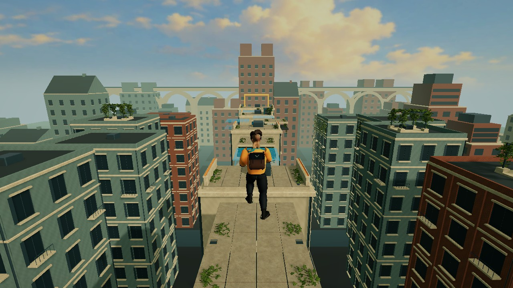
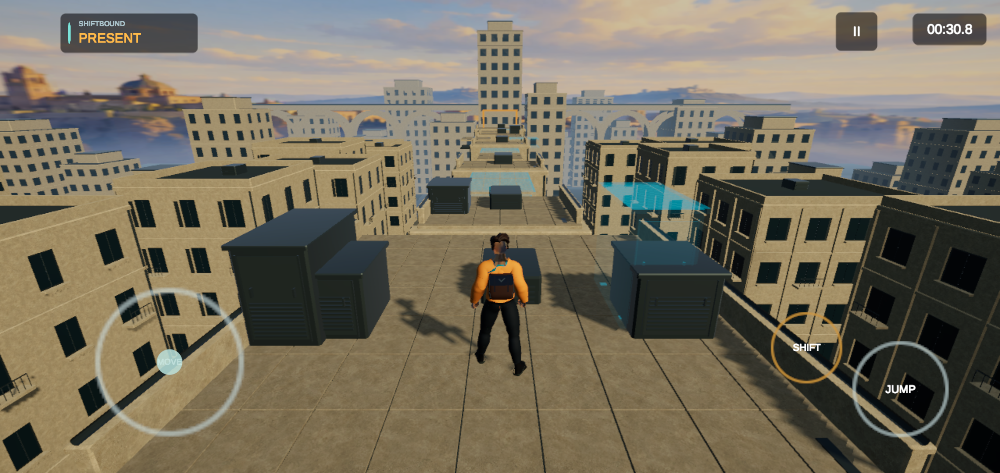
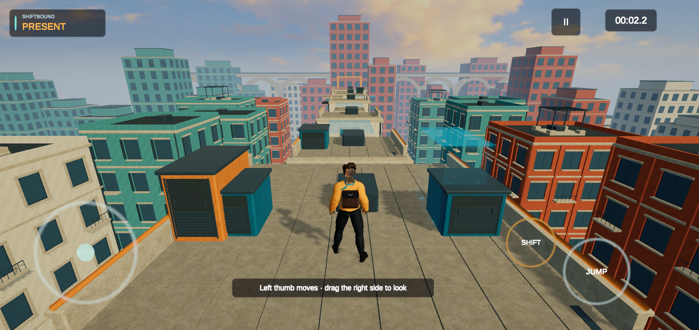
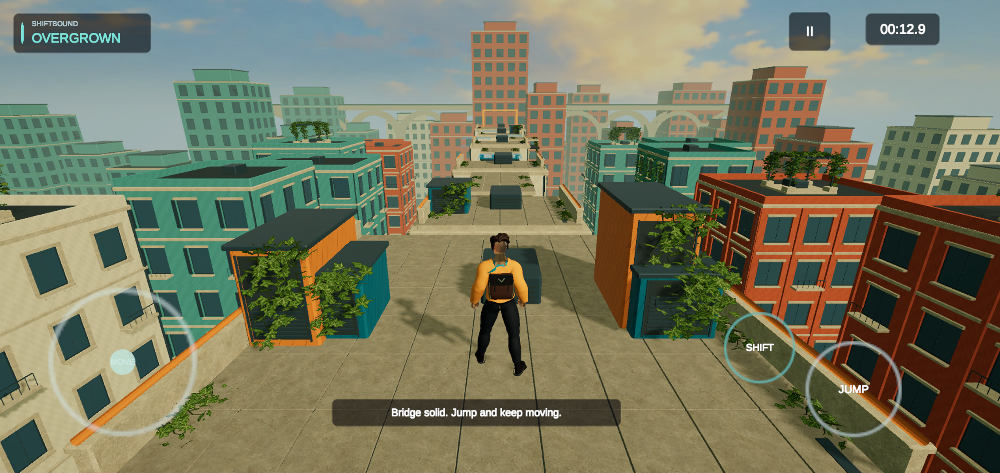

# Production review checkpoint - 11 October 2026

This is an unfinished production upgrade of the existing Present/Overgrown rooftop slice. No levels were added. Review the actual images and video before assigning a score; there is no independently established overall rating or claim of excellent production quality.

**Current source to review:** branch `production/courier-city-upgrade`, build35 canonical source fingerprint `5ff864643318b866655c43451d8e42651773152d71a5b3d37214b612add42c1a`. [Build identity](build35.json). The source was dirty over base revision749d570 when built; the fingerprint, rather than that base revision alone, identifies the candidate. Windows and Android artifacts match this fingerprint. Samsung testing is paused by request;35 has not been installed there. Latest installed27 was rejected by the owner for poor motion and presentation. Historical22 evidence below must not be used as35 acceptance.

## Current local production pass

The courier has an authored jacket torso and articulated sleeves, planted speed-matched strides, an airborne pose that retains knee lift at the apex, bent elbows and descent reach. The previous runtime layer derived lift from positive vertical speed, allowing the pose to relax toward standing at the apex/descent. Camera vertical damping is continuous across the arc; movement collision, gravity, jump reach and immediate input remain unchanged.

Below the route are composed streets, pavements, shopfronts and an enclosed planted courtyard. Distant blocks have three architectural types rather than one repeated grid. Brick colour and baked sky reflection were repaired after direct inspection found an offline interpolation error. No playable levels or route colliders were added. [Authoring and provenance](../ProductionUpgrade/README.md).

| Current local evidence | Identity and limits |
|---|---|
| [Present](desktop35-present.jpg) | Build35, normal Desktop/D3D11 profile,1280x720 game-camera readback at opening position; overlay UI excluded. |
| [Airborne](desktop35-airborne.jpg) | Actual35 route apex, Overgrown, grounded=false, vertical velocity0.197m/s;1280x720. |
| [City depth](desktop35-city-depth.jpg) |35 fixed starting position with diagnostic downward orbit;1280x720, not a normal forward camera or playable ground level. |
| [Automated desktop gameplay](desktop35-automated-gameplay.mp4) |35 normal window/UI,18s,1280x720,30 capture frames/s. Synthetic production-input route, both worlds and airborne Shift. Recording overhead; not a performance measurement or human-input evidence. |
| [Preserved WindowsPolished reference](desktop-polished-reference.png) | Actual existing executable, source2bb476b1bfeab5a5e232f16847b8b948bf2114829b7b975ffe6dc129622e92bb, base f23a3a7, built9October. The owner prefers its gameplay. Different scene/rig/clips/camera; not a pixel-matched before/after or merely a different quality setting. Original executable folder is preserved. |

Focused local checks:35 completed full production-input traversal including airborne Shift, three checkpoints and completion; normal-window recording completed two further full routes. Nominal route rate60 is a scripted setting, not measured60FPS. Four focused retry cycles passed on34; gameplay scripts and scene have identical manifest hashes in35, which changes surface/reflection assets. A hidden-window retry run failed fresh-jump detection; an owned, focused-window rerun passed. [Check markers and limitations](automated-checks35.txt).

Both35 builds compile. [Fresh APK inspection](artifact35.json) passes signing,16KB ZIP alignment and all seven native LOAD alignments. RELRO end alignment still fails `libc++_shared.so`, `libmain.so`, `libunity.so`; vendor runtime/dependency fixes are required. This is a failed compatibility gate under [Android's official guidance](https://developer.android.com/guide/practices/page-sizes). AAB-generated APKs and a supported separate16KB runtime remain unverified.

| Current production acceptance category | Status | Evidence/remaining work |
|---|---|---|
| Samsung visual quality | NOT VERIFIED |35 local changes inspected; phone27 rejected. No35 native before/after. |
| Courier and motion | NOT VERIFIED |Local airborne/stride defects improved; foot roll, fine deformation and transitions remain weak. No35 device or independent art approval. |
| Two-thumb interaction and camera | NOT VERIFIED |Local automated traversal passes; physical finger comfort untested. |
| Sustained Samsung performance | NOT VERIFIED |No35 measurements; historical22 short run does not establish20-minute60FPS. |
| Lifecycle, recovery and persistence | NOT VERIFIED |Focused local retry passes;35 physical rotation, Home/Back/lock/process-death verification incomplete. |
| Android artifact compatibility | FAIL |Three vendor RELRO failures; AAB and16KB runtime missing. |
| Independent human/art evaluation | NOT VERIFIED |Owner's latest phone evaluation was negative;35 independent review pending. |

Remaining weaknesses: distant architecture and the continuous far horizon still look artificial; flat glazing, sparse growth and repetitive facade fields need further coherent authoring. The courier needs heel/toe contact, braking transitions and finer outfit/deformation review. Desktop captures cannot establish Android quality or frame pacing. There is no substantiated overall rating, and the milestone remains open.

## Historical Samsung22/24 evidence

The remainder records22 and subsequent24 correction only. It is preserved for comparison. Latest phone27 and current local35 supersede its former latest-build status.

## Physical-device evidence

Samsung Galaxy S10+ SM-G975U, Android11/API30, Snapdragon855/Adreno640, RAM7395MB, display2280x1080/60Hz,4096-byte pages. The device was USB connected/charging. Unique device identifiers and raw private logs are excluded.

| Capture | Identity and limits |
|---|---|
| [Present before](before13-present.png) / [after](after22-present.png) | Real Samsung PNGs,2280x1080, opening position(0,.08,1), yaw0/pitch18.13 before;22 after. UI safe-area/control preferences differ. |
| [Overgrown before](before14-overgrown.png) / [after](after22-overgrown.png) | Real Samsung PNGs, same opening pose.14 before already includes early render repairs; this is not a pristine original13 Overgrown baseline. |
| [Automated gameplay](samsung22-automated-gameplay.mp4) | Actual Samsung22 rendering,120s, repeated production-input route, both-world camera orbits, real airborne Shift, falls/recovery/checkpoints/completion. Re-encoded1140x540 from native recording; recording affects performance. Synthetic input, not human fingers. |
| [Historical24 jump](jump24-before.mp4) | Actual Samsung24 recording excerpt,14s,1140x540. Retained as motion baseline; not current35 footage or human interaction. |
| [Normal desktop Present](desktop22-present.png) / [Overgrown](desktop22-overgrown.png) | Matching22 source, D3D11 normal profile. Actual capture1280x910; same position/yaw/pitch/world, different aspect from phone. Not a pixel-matched comparison. |
| [Desktop mobile diagnostic failure](desktop22-mobile-diagnostic-failure.png) | Actual serialized mobile pipeline used, but colour severely clips. It is a failed diagnostic, not a proxy for phone appearance. Runtime variant/backend cause remains unconfirmed. |

## What caused the mobile quality difference

Confirmed: installed13 rendered1280x606 behind2280x1080 native UI, only31.5% of native scene pixels. Scene softness was substantial.22 renders1536x727 (about45% native pixels),2xMSAA,FSR sharpness.35,HDR32/ACES,GLES3,1024 main shadow/one cascade/35m,no mobile SSAO. See [runtime snapshot](render-state22.txt). This is a measured mobile budget, not the desktop profile copied wholesale or proof of sustained60FPS.

Confirmed shared art defects compounded the rendering difference: repetitive flat beige facades, weak contact/material response and a blurred painted second skyline disconnected from constructed scenery. Authored colour/material/surround/coping/service-equipment/terrace/attached-growth changes and the22 sky-UV repair address these. The courier outfit/rig, native HUD, texture binding, four skin weights and grading repairs from interrupted work were retained. [Provenance](../ProductionUpgrade/README.md) identifies original authoring and retained CC0 sources.

Not established: missing textures/material fallback or an unsupported shader in the installed13 baseline. Inspected foliage/sky textures loaded with supported shaders and mip0. The owner's older desktop video has unknown build identity. The desktop mobile-profile clipping remains a separate unresolved diagnostic. No claim that the Samsung is too weak, and no Vulkan superiority claim without a comparison.

## Motion and gameplay changes

22 has gait cadence calibrated to source clip length/stance travel, opposing arm/knee curves within the real ascent, running impact/contact polish, bounded camera ascent lag, eased3-degree running FOV, comfortable-action placement candidate and Jump-to-Shift slide ownership preserving Jump hold. Input never waits for animation. Instant retry retains the scene and resets motor/input/world/triggers/checkpoint/camera/audio/lessons, removing reload stalls.

The inspected22 footage still shows a tucked/stiff airborne courier, imperfect foot/contact behavior and abrupt pose changes. **24 reduces knee tuck, extends descent legs, authors a short landing compression/return, replaces the inherited half-height/1.27s body collapse with a3cm/0.16s landing response, disables airborne clip looping, and triggers takeoff from actual motor launch events including buffered contact jumps.** Height/gravity/collision/reach are unchanged.24 motion has not been watched on the device after the owner stopped testing.

## Historical22 verification and acceptance

22 full current-source automated suite passed:11 jump/18 touch assertions; regression, smoke and reach audit; synthetic touchscreen ownership/cancellation/simultaneous contacts/suspend-resume/retry; deterministic routes30/60/120/144/variable; production-input routes30/60/120/144; four retained-scene retry cycles. [Pass markers](automated-checks22.txt). These are22 results, not24 regression evidence. Physical22 automation also passed both-world full orbit, input-driven fall/checkpoint recovery and repeated complete routes.

22 unrecorded presentation run was stopped by owner after223.578s,8 completed routes,12,918 intervals. p50=16.923ms,p95=17.002ms,p99=33.862ms,max35.396ms;354 estimated missed60Hz slots (2.67%), no intervals over50ms, no polling errors/gaps. It is **not the requested20-minute acceptance**. USB charging/warm device; no cold-versus-sustained/unplugged conclusion. [Summary](performance22-summary.json), [minute/memory/thermal analysis](performance22-partial.json). Available counters have the limits of SurfaceFlinger presentation sampling; these are not FrameTimeline deadline attribution or physical input latency.

22 static APK inspection: all LOAD alignments16KB, ZIP16KB alignment and signature pass. libc++_shared.so,libmain.so,libunity.so RELRO ends fail; libgame.so/libswappywrapper.so and source-built libraries pass. [Exact report](artifact22.json). A supported vendor-runtime fix remains required; no binary patch/mixing.24 has not been freshly inspected. AAB-generated APKs and a separate16KB runtime remain unverified. This4KB phone does not establish16KB support.

| Production acceptance category | Status | Evidence/remaining work |
|---|---|---|
| Samsung visual quality | FAIL |22 looks clearer/more colourful, but repeated architecture, flat glazing, weak skyline depth/contact remain below the requested production bar. |
| Courier and motion | NOT VERIFIED |22 pose defects observed;24 corrections require device review. |
| Two-thumb interaction and camera | NOT VERIFIED |Automation passed functional routes; no human finger comfort or24 camera/motion acceptance. |
| Sustained Samsung performance | NOT VERIFIED |Owner stopped the planned20-minute run;22 short run shows2.67% missed slots. |
| Lifecycle, recovery and persistence | NOT VERIFIED |22 automated recovery/retry pass; actual-device rotation, Back/Home/lock/resume and process-death checkpoint retention incomplete. Same-key updates preserved app data. |
| Android artifact compatibility | FAIL |Known22 vendor RELRO failures;24 fresh inspection/AAB/16KB runtime missing. |
| Independent human/art evaluation | NOT VERIFIED |No independent review or player session has been completed. |

## Independent review request

Inspect the current branch,35 local gameplay/images and historical native Samsung evidence separately. Identify the strongest improvements and largest remaining player-facing weaknesses, prioritizing mobile readability, courier motion/contact, landing visibility, world coherence and pacing. Rate only aspects you can substantiate and disclose that35 has no native device footage yet. Do not infer thumb comfort, sustained performance or16KB compatibility from screenshots or a passing scripted route. Do not average a failed major gate into overall production acceptance.

Optional future hands-on retest, only when the owner wants it: move forward, hold Jump and slide that thumb onto Shift before landing; immediately reverse after landing and retry once after a fall. Report the single worst input/camera issue. No physical-comfort result is claimed now.

